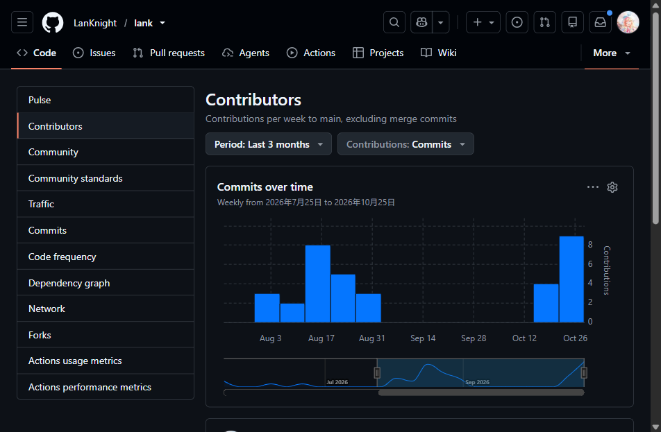
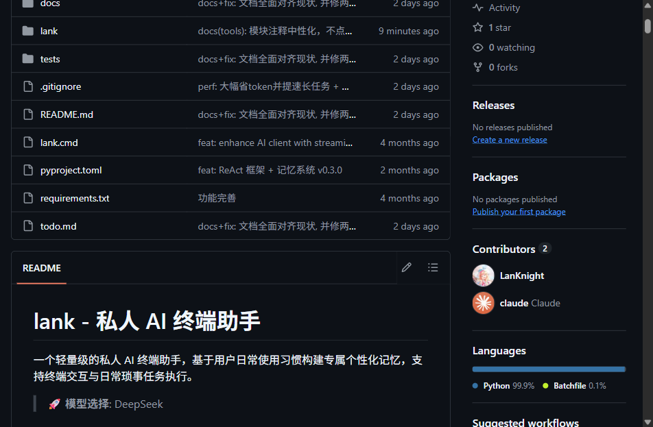
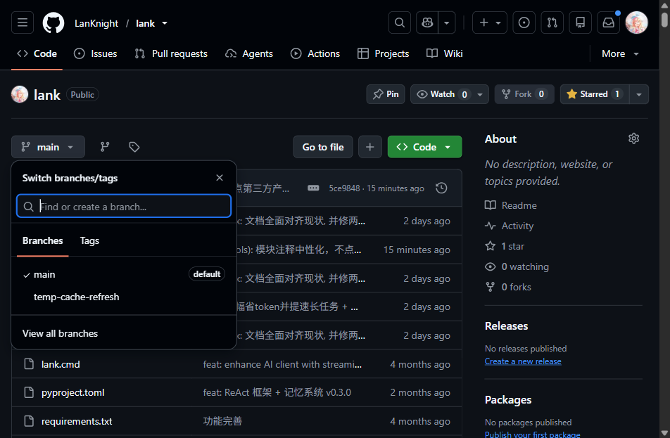
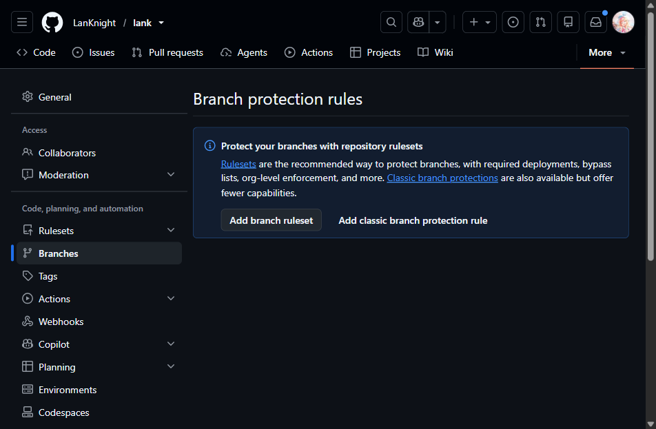
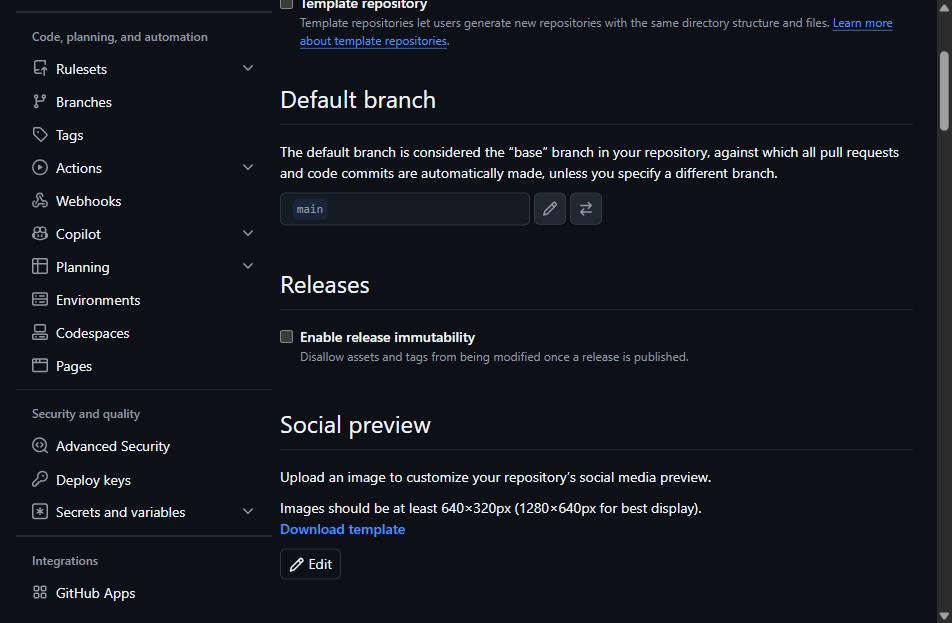
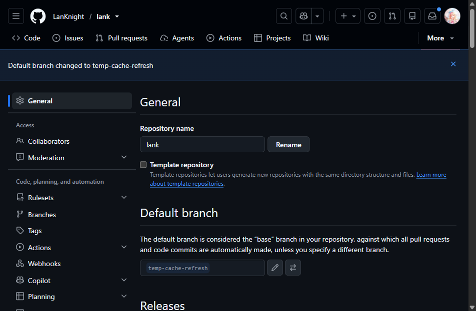
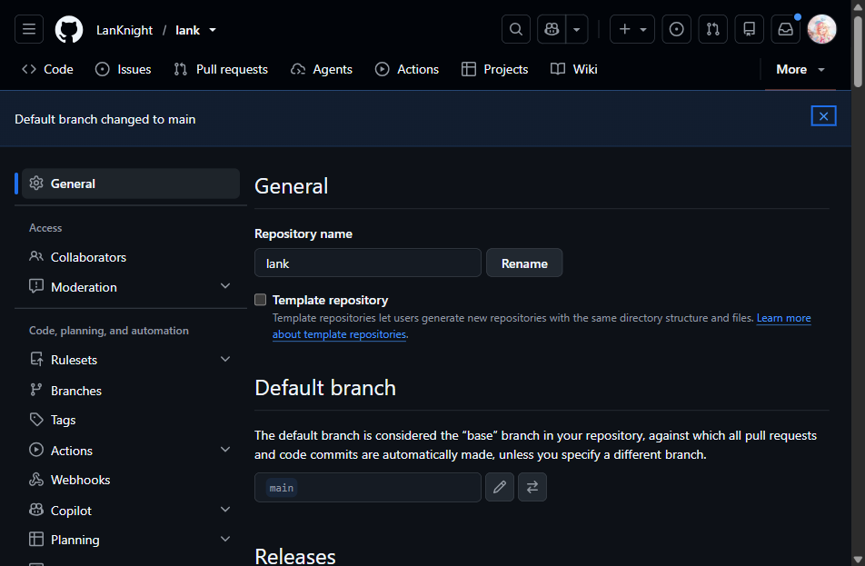
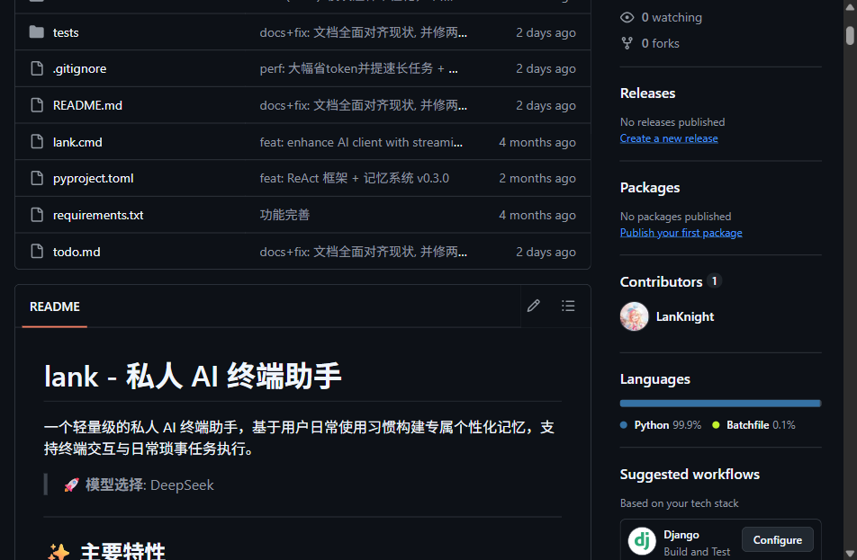

# 如何把 GitHub 仓库里的「Claude 署名」彻底删掉（完整版·含实操截图）

—— 从 lankhub 首战的"以为干净了"，到 lank 再战才发现还剩一层

一年前我写过一篇《如何把 GitHub 仓库里的「Claude 署名」彻底删掉 —— 一次实战全记录》。当时在 `LanKnight/lankhub` 上把 `Co-Authored-By: Claude` 尾注清干净，切了默认分支，首页侧栏从 2 人变成 1 人，收工。

后来在 `LanKnight/lank` 上重做同一件事，严格按那篇文章的步骤走了一遍：`git log` 全绿、`contributors-data` 只剩自己、commit 搜索 0 命中——**仓库首页右栏的 Contributors 依然挂着 claude，计数还是 2**。

于是回去把"层③"拆开重看。结论有点意外：三层模型没错，但层③里面藏着**两个不相干的数据源**，原文只认了其中一个，把另一个归成了"缓存滞后、等 24 小时"。照着做的人就会卡在我卡过的地方。

这篇是完整版：保留原文全部结论，修正三处会让人白忙的判断，补上第二份服务端缓存的定位与刷新方法，配上这次实操的八张截图，最后加一节"怎么让 AI Agent 替你干这件事"。

---

## 一、先认清：署名不是三层，是「三层五处」

原文的三层划分方向是对的，问题出在第三层不够细。完整模型如下：

| 编号 | 它到底是什么 | 在哪能看到 | 删除手段 | 生效延迟 |
| --- | --- | --- | --- | --- |
| 🟩 ① | **当前历史**：提交信息里真有 `Co-Authored-By: Claude <noreply@anthropic.com>` 尾注 | `git log`、commit 页、`.patch` | 重写历史（filter-repo / filter-branch） | 即时 |
| 🟨 ② | **本地旧对象**：分支 / tag / `refs/original/` / reflog / stash 仍指向老提交 | `git for-each-ref`、`git fsck --unreachable` | 删引用 + `reflog expire` + `gc --prune=now` | 即时（仅本地） |
| 🟥 ③-A | **commit 图索引**：Insights 折线图、`/repos/{o}/{r}/contributors`、`/stats/contributors`、`/graphs/contributors-data` | 图表页、API | 等 GitHub 重算 | 十几分钟到数小时 |
| 🟥 ③-B | **仓库首页右栏 Contributors**：走 `/_sidebar` 端点，是一份独立的仓库级贡献者统计 | 仓库首页右侧边栏 | **切默认分支来回**，逼重算 | 约 30 秒 |
| ⬜ ③-C | **服务端旧对象直链**：老 commit 的 URL 短期仍可打开 | `/commit/<老SHA>` | 等它自然过期，或提 Support | 数天 |

两条必须先记住的判断：

- **③-A 干净 ≠ ③-B 干净。** 原文把 `/graphs/contributors-data?all=1` 当成"唯一权威"，实测会翻车：该接口只剩你自己时，首页右栏照样显示 2 人。
- **③-C 不影响名单。** 老 commit 直链残留是正常的对象缓存，不参与贡献者统计。别为它再重写一次历史。

### 为什么首战会以为"已经干净了"

把两次实战摆在一起，问题一目了然：

| 环节 | lankhub（首战） | lank（再战） |
| --- | --- | --- |
| 层① 重写 | filter-repo | filter-branch（国内装不上 filter-repo） |
| 层② 清理 | 删备份 tag + gc | 删 `refs/original` + gc |
| 层③ 判断依据 | `contributors-data?all=1` 只有自己 | 同左，也确认只有自己 |
| 层③ 处理 | 直接切默认分支，侧栏变 1 人 | **先误判成浏览器缓存**，硬刷新折腾几轮无果 |
| 结果 | 收工 | 继续深挖才发现侧栏读的是 `_sidebar` |

差别在于：lankhub 那次运气好，切分支顺手把两份缓存都刷新了，于是"切分支有效"被记成了结论；lank 这次先查 API 看到干净，就急着下"是你浏览器缓存"的判断，反而绕了远路。**顺序错了，结论就错。**

### 按症状直达

先对一下你看到的现象，直接跳到对应小节，不用从头读。

| 你看到的现象 | 问题在哪层 | 直接跳到 |
| --- | --- | --- |
| 仓库首页右栏 Contributors 里有 AI 账号 | ③-B | 2.3.2 → 4.3 |
| Insights → Contributors 图表里有 AI 账号 | ③-A | 2.3.1 → 4.2 |
| `git log` 能看到 `Co-Authored-By` | ① | 2.1 → 4.1 |
| 推送报 `stale info` | ①（本地引用错位） | 4.1.1 → 4.1.3 |
| 老 commit 链接还能打开 | ③-C | 正常现象，等过期 |
| 控制台中文乱码、以为提交信息坏了 | 工具链 | 2.1 里的提示框 |

---

## 二、排查：怎么判断卡在哪一层

原文的排查顺序可用，这里补上第三层的细分判据和实拍图。

### 2.1 看当前历史里到底还有没有署名

```bash
# 提交信息里搜（-i 忽略大小写）
git log --all -i --grep="Co-Authored-By: Claude" --format="%h %s"

# 只看当前分支（去掉 --all），这是"现存历史"的真实情况
git log -i --grep="Co-Authored-By" --format="%h %s" main
```

- `--all` 命中、`main` 不命中 → 问题在 🟨，别的引用挂着老历史。
- `main` 也命中 → 问题在 🟩，要重写。

看完整信息，确认尾注真实格式（正则要按实际写，别照抄别人的）：

```bash
git --no-pager log --all -i --grep="claude" --format="===%h===%n%B" -n 10
```

顺带核对作者身份。若 `author` 邮箱本身就是 AI 账号关联的邮箱，光删尾注没用，还得改 author：

```bash
git --no-pager log --all -i --grep="claude" --format="%h %an <%ae> | %cn <%ce>"
```

> ⚠️ `git log` 无匹配时**退出码也是 0**，别用退出码判断"有没有署名"，只看有没有输出。
>
> ⚠️ PowerShell 里 git 的进度和警告走 stderr，会标红一片，看着像报错其实正常。判断成败看 `$LASTEXITCODE` 与实际输出行。

> 🕳️ **新增坑：中文提交信息显示成 `鏂囨。` 这种乱码，不等于仓库坏了。** 用 `>` 或 `Out-File` 重定向 `git log` 输出时，PowerShell 会做一次编码转换。想确认原始字节，让 Python 直接读：

```powershell
python -c "import subprocess;d=subprocess.run(['git','log','-1','--format=%B'],capture_output=True);open('_verify.txt','wb').write(d.stdout)"
```

用 UTF-8 编辑器打开 `_verify.txt` 再看。我这次差点因为控制台乱码以为提交信息被改坏，白查了半天。

### 2.2 看远端和本地分别还有哪些引用

```bash
# 远端全部引用 —— 重点看有没有你本地没拉过的"古董分支/Tag"
git -c http.proxy=http://127.0.0.1:7897 -c https.proxy=http://127.0.0.1:7897 ls-remote origin

# 本地全部引用（分支/tag）与指向的对象
git for-each-ref --format="%(objecttype) %(refname) %(objectname:short)"

# 本地不可达对象（gc 前会被列出来，gc --prune=now 后才清零）
git fsck --unreachable --no-progress | Measure-Object -Line
```

> 🕳️ 原文记的大坑依旧值得重复：`for-each-ref` 看本地、`ls-remote` 看远端，两边都要查。首战时本地就藏着一枚 `backup-before-rewrite` 的 tag，指着 27 个带署名的老提交。只要它还"可达"，一次手滑的 `push --mirror` 就能让署名原地复活。

顺手确认工作区干净：

```bash
git status --porcelain
```

### 2.3 看服务端：这一节是全文重点

原文这里只有一句"用两处交叉验证"——`contributors-data?all=1` 加首页右栏。实测这句会把人带偏，因为**这两处根本不是同一个数据源**。

#### 2.3.1 先查 ③-A：图表与 API

四路探针，建议都跑：

```powershell
# 1) 仓库贡献者 API
python -c "import json,urllib.request;u='https://api.github.com/repos/<owner>/<repo>/contributors';r=urllib.request.urlopen(urllib.request.Request(u,headers={'User-Agent':'Mozilla/5.0'}),timeout=30);print([x['login'] for x in json.loads(r.read())])"

# 2) 提交统计 API（浏览器直接打开）
#    https://api.github.com/repos/<owner>/<repo>/stats/contributors

# 3) 图表数据接口（浏览器直接打开，未登录可访问）
#    https://github.com/<owner>/<repo>/graphs/contributors-data?all=1

# 4) commit 搜索（网页版搜 co-authored-by，或带 cloak-preview Accept 头的 search API）
```

判读：

- 全部只剩你自己 → ③-A 干净，继续查 ③-B。
- `contributors-data` 返回 **202** → GitHub 正在后台重算，等；返回 **200** 且只剩你自己 → 重算完成。
- 命中 `403 rate limit exceeded` → 匿名 API 限流，**不是**"没删干净"。换不需要 token 的 3 号探针，或等几分钟。

下图是这次 lank 仓库的 Insights → Contributors 页，重写推送后它已经只剩一个人：



*图 1：图表页只认 commit 作者，所以它比侧栏更早变干净。看到这张图就以为"全部搞定"，是最容易踩的坑。*

#### 2.3.2 再查 ③-B：首页右栏，必须用登录态浏览器

同一时刻，仓库首页右栏长这样：



*图 2：图表 1 人、侧栏 2 人——这张图就是"两份缓存不同步"的直接证据。*

这里有两个反直觉事实：

**其一，老端点已经废弃。** 网上流传的 `/contributors_list?count=10` 现在恒返回空列表：

```html
<ul class="list-style-none ">
</ul>
```

拿它当证据只会得出"已经干净了"的错误结论。新版页面真正取数的是 `/_sidebar`，未登录直接请求返回 `406`，属正常。

**其二，未登录看不到侧栏名单。** 未登录只会渲染骨架屏：

```html
<h2><span>Contributors</span></h2>
<div class="prc-SkeletonText-..." data-text-skeleton-size="bodyMedium"></div>
```

所以"我用脚本抓首页 HTML，里面没有 claude"**不能**证明侧栏干净。必须用登录态浏览器实地看，并且截图留证。

#### 2.3.3 三条判据：证明问题在服务端，而不是你的浏览器缓存

用"硬刷新没用"就断言"肯定是缓存"是错的，得拿证据。这次我是这么定性的：

**判据一：看端点响应头。** `/_sidebar` 返回：

```
Cache-Control: no-cache
```

`no-cache` 的意思是"每次都要回源校验"。既然每次回源还显示旧数据，说明**旧数据在 GitHub 服务端**，本地怎么刷都没用。

**判据二：两个数据源口径不一致，就是对不上的铁证。**

| 观察点 | 修好前 | 修好后 |
| --- | --- | --- |
| 首页右栏 Contributors | 2 人（自己 + claude） | 1 人 |
| Insights → Contributors 图表 | 1 人 | 1 人 |
| `contributors-data?all=1` | 1 人 | 1 人 |

侧栏 2 人、图表 1 人——这就是 ③-B 未重算的典型特征。原文那句"两者不一致 = 缓存滞后"方向是对的，只是没说清究竟是**哪一份**缓存在滞后。

**判据三：只有登录态能看到名单。** 见上。所以这件事的最终判据永远是"登录态浏览器 + 截图"，不是 curl。

---

## 三、为什么 @claude 会被算成贡献者

原文的机制解释依然成立，这里补上"为什么两份数据源会不同步"。

关键机制：GitHub 判定一次提交归属，看的是提交里的 Author / Co-author 邮箱，再拿邮箱去全网匹配已注册账号。

```
Co-Authored-By: Claude <noreply@anthropic.com>
└── 这个邮箱恰好关联到真实账号 @claude（ID 81847）
⇒ 头像就永久挂上了仓库首页
```

在这之上还有一层：**不同产品面的统计口径与刷新时机不同。**

- commit 图索引（③-A）按"默认分支可达提交"重算，重写推送后十几分钟到数小时就跟上；
- 仓库侧栏 Contributors（③-B）是另一份仓库级缓存，只在特定事件（默认分支变更、仓库元数据变更）时失效。

于是就有"图表已干净、侧栏还是 2 人"的窗口期。原文把这段窗口期整体归为"等 24 小时"，实际它可以用切默认分支手动触发，不用干等。

> 🔑 一句话：**重写历史只能回收"提交里的邮箱"，回收不了"服务端已经缓存好的贡献者名单"。** 后者得单独处理。

---

## 四、删除手段总览（按风险从低到高）

### 4.1 层①：重写当前历史

#### 方案 A：git filter-repo（首选）

```bash
git filter-repo --force --message-callback "
import re
return re.sub(rb'(?im)^Co-Authored-By:\s*Claude[^\n]*\n?', b'', message)
"
```

原文没提、但实测一定会撞上的两个坑：

- **必须加 `--force`。** `filter-repo` 默认拒绝在非 fresh clone 上重写历史，报 `expected fresh clone`。
- **它会动 `origin`。** 不同版本行为不一致（可能直接移除，也可能改名备份）。跑完先看一眼：

```bash
git remote -v
```

空了就补回来，再继续：

```bash
git remote add origin https://github.com/<owner>/<repo>.git
```

国内装不上也有办法：

```bash
python -m pip install --proxy http://127.0.0.1:7897 git-filter-repo
```

我这次两种装法都报 `SSL: UNEXPECTED_EOF_WHILE_READING`，索性直接走方案 B。

#### 方案 B：git filter-branch（零依赖兜底，本次实际采用）

先把剥离逻辑写成独立脚本，放**仓库外**，避免污染工作区：

```python
# D:\tools\_strip_coauthor.py
import re
import sys

data = sys.stdin.buffer.read()

# 删除整行 co-authored-by 尾注（大小写不敏感，按你的实际格式调整）
pattern = re.compile(rb"(?im)^[ \t]*co-authored-by:[ \t]*(claude|anthropic)[^\n]*\n?")
data = pattern.sub(b"", data)

# 压掉尾部多余空行，避免留下连续空行
data = re.sub(rb"\n{3,}", b"\n\n", data).rstrip(b"\n") + b"\n"

sys.stdout.buffer.write(data)
```

> 用二进制读写是关键。提交信息是 UTF-8 字节，文本模式在 Windows 上很容易被转码破坏。

然后只重写当前分支：

```powershell
git filter-branch -f --msg-filter "python D:/tools/_strip_coauthor.py" -- HEAD
```

预期输出一串 `Rewrite <sha> (n/总数)`，最后是 `Ref 'refs/heads/main' was rewritten`。

**为什么坚持不用 `--all`**——这是原文完全没有的坑：

`--all` 会把 `refs/remotes/origin/main` 一起重写。结果是本地记录的"远端值"变成新 SHA，而真实远端还是旧 SHA，接着 `--force-with-lease` 直接失效（它拿本地记录去比对），表现是莫名其妙的 `stale info`，或者干脆没提示就推上去了。

只用 `HEAD` 或 `main`，不碰任何远端引用，最稳。如果你已经跑了 `--all`，按 4.1.1 修回来。

#### 4.1.1 重写后必须做的引用修复（新增）

```bash
# 1) 看远端追踪引用被改成什么样了
git for-each-ref --format="%(refname) %(objectname:short)" refs/remotes

# 2) 恢复成真实远端值（重写前用 git ls-remote origin 记下的那个 SHA）
git update-ref refs/remotes/origin/main <旧SHA>
```

`origin/HEAD` 原本是**符号引用**（指向 `origin/main`），`update-ref` 会把它变成普通引用，必须改回来：

```bash
git symbolic-ref refs/remotes/origin/HEAD refs/remotes/origin/main
git symbolic-ref refs/remotes/origin/HEAD   # 确认输出 refs/remotes/origin/main
```

#### 4.1.2 重写后立刻做三项校验（新增）

```bash
# 校验一：尾注真的没了（应无输出）
git log --all -i --grep="co-authored-by" --format="%h %s"

# 校验二：代码内容一字未变（应无输出）
git diff --stat <重写前的完整SHA> HEAD

# 校验三：提交数量没变
git rev-list --all --count
```

校验二不通过，说明脚本读错了 stdin，立刻回滚：`git reset --hard <重写前的完整SHA>`。

#### 4.1.3 推送 + 本地物理清理

```bash
git push --force-with-lease origin main
```

成功的样子：

```
 + 43b32f1...5ce9848 main -> main (forced update)
```

报 `stale info` 的两种解法：

```bash
# 做法一：重新对齐远端追踪引用
git fetch origin
git push --force-with-lease origin main

# 做法二：显式声明你预期远端是哪个 SHA
git push --force-with-lease=main:<旧SHA> origin main
```

推送成功后清本地备份引用（即原来的层②）：

```bash
git for-each-ref refs/original --format="%(refname)"
git update-ref -d refs/original/refs/heads/main
git update-ref -d refs/original/refs/remotes/origin/main

git reflog expire --expire=now --all
git gc --prune=now
git fsck --unreachable --no-progress | Measure-Object -Line   # 复查应为 0
```

> 🗑️ 删完一定要 `git cat-file -t <老SHA>` 验证——返回 `fatal: Not a valid object name` 才算真没了。此后无论普通 push 还是 `--mirror` 都推不回去。这一步过了，层②才算真正关闭。

### 4.2 层③-A：等服务端索引重算

重写推送后，`contributors-data?all=1` 会先返回 **202**（重算中），过一段时间变成 **200** 且只剩你自己。lank 这次是几小时内跟上的，不需要任何额外操作。

如果几小时后仍是 2 人，说明历史没重写干净，回 4.1.2 复查，别急着去刷缓存。

### 4.3 层③-B：切默认分支逼重算（保姆级五步）

原文的招数是对的，但**页面路径已经变了**，这是第二处必须修正的地方。

#### 第 1 步：准备临时分支（必须与主分支同一个 commit）

```bash
git branch temp-cache-refresh main
git push origin temp-cache-refresh
```

原文用 `--allow-empty` 造了个空提交，其实不需要。同一个 commit 更好：切换期间仓库对外显示的内容**零差异**，只是换了个分支名。

推上去之后，在仓库首页分支下拉里应该能看到它：



*图 3：确认临时分支已推送成功——下拉里除了 main，多了 temp-cache-refresh，且 main 旁标注 `default`。*

#### 第 2 步：找对设置页（新手最容易卡在这里）

> ⚠️ **GitHub 新版已把 Default branch 从 `Settings → Branches` 迁到 `Settings → General`。**

先看 `Settings → Branches`：现在只剩 Branch protection rules 和 rulesets，**没有 Default branch**。照老教程在这页找，会以为功能被下线了：



*图 4：如果你在这一页找 Default branch，说明走错了。点了也没用，直接换去 General。*

真正的入口在 `Settings → General`，往下滚到 **Default branch** 区块，右侧就是切换按钮（一个双向箭头图标），左边铅笔图标是重命名：



*图 5：这是你要找的地方。当前值 `main`，右边两个图标——铅笔是重命名，双向箭头才是切换默认分支。*

#### 第 3 步：切到临时分支

点击双向箭头 → 弹窗 `Switch default branch to another branch` → 下拉选 `temp-cache-refresh` → 点 `Update` → 出现二次确认 `I understand, update the default branch.` → 确认。

成功后页面顶部会出现横幅，字段值也变成 temp-cache-refresh：



*图 6：看到这条绿底横幅，说明切换已经生效。记一下时间，后面要等 30 秒。*

#### 第 4 步：等 30~40 秒，切回 main

同样的路径选回 `main`，横幅应显示 `Default branch changed to main`：



*图 7：切回来了。两次切换之间要留出 30 秒以上，太短 GitHub 来不及重算。lank 这次是 35 秒。*

#### 第 5 步：验证

回仓库首页，等侧栏懒加载完成（可能要点一下或等 10 秒），Contributors 应变成 1 人；再按 `Ctrl+Shift+R` 硬刷新确认稳定：



*图 8：计数从 2 变成 1，claude 消失。硬刷新后依旧如此，才算真正完成。*

#### 第 6 步：删掉临时分支

```bash
git push origin --delete temp-cache-refresh
git branch -D temp-cache-refresh
git remote prune origin
```

> 🕳️ 删除可能报 `Recv failure: Connection was reset`，是网络抖动，先重试一次；仍失败就走代理。删完务必 `git remote prune origin`，否则本地会留一个 `refs/remotes/origin/temp-cache-refresh` 幽灵分支，以后每次 `for-each-ref` 都能看到它。

### 4.4 兜底方案（前面都不奏效再考虑）

| 方案 | 代价 | 说明 |
| --- | --- | --- |
| 🔁 orphan 空历史强推覆盖 main | ⚠️ 高：默认分支短暂"几乎空" | 社区"休克疗法"，比切分支暴力 |
| 🎫 提 GitHub Support 工单 | 🕐 慢：等回复，需登录 | 说明"已 force push 清理历史，请求清除贡献者缓存"，附操作时间 |
| 🗑️ 删库重建 | 💸 最高：丢 star / issue / 旧 URL | 100% 干净，但非必要不建议 |

---

## 五、踩坑清单（原文 9 条 + 新增 8 条）

原文那 9 条依然有效，其中第 1 条需要补一个关键限定。

1. 🚫 「删了还在」几乎都是缓存层，不是历史层。**但缓存层有两份，别只认一份。** 先分清 ①②③-A ③-B，再动手。
2. 🕳️ 本地备份 tag / 分支是复活的种子。`for-each-ref` + `ls-remote` 双查，任何指向老历史的引用都要删干净，再 `reflog expire` + `gc --prune=now`。
3. 🧾 filter-branch 会留 `refs/original/`。不清掉等于白重写。
4. 📛 老 SHA 直链会残留一阵。`/commit/<老SHA>` 短期还能打开、还带尾注，那是服务端旧对象缓存，不影响侧栏和统计，会自行过期。
5. 🏷️ 「标题里出现 Claude」≠「署名」。搜到"清理 Claude Code 残留"这类提交标题很正常，它不是 co-author 尾注，不会被算成贡献者。
6. 🔌 国内网络 push 被重置就走代理。
7. 🖥️ PowerShell 里 git 的 stderr 会标红，看着像报错其实正常。
8. 🔐 默认分支切换需要登录态。自动化别替你填凭据，先人工登录。
9. ✉️ 根因在邮箱映射。历史上出现过 `noreply@anthropic.com` 这类被 GitHub 关联到真实账号的邮箱，头像就会挂上——从源头规范 `git config user.email` 才能治本。

以下是这次新增的：

10. 🆕 **`contributors-data` 干净 ≠ 侧栏干净。** 两者是不同数据源，侧栏走 `/_sidebar`。这是本篇存在的原因。
11. 🆕 **`/contributors_list` 已废弃。** 它恒返回空 `<ul>`，拿它当证据会得出"已经干净了"的错误结论。
12. 🆕 **未登录看不到侧栏名单。** 未登录只有骨架屏，脚本抓 HTML 永远"干净"，判断必须用登录态浏览器。
13. 🆕 **`filter-branch --all` 会污染远端追踪引用。** 重写后 `--force-with-lease` 失效，`origin/HEAD` 也会从符号引用退化成普通引用。
14. 🆕 **`filter-repo` 默认拒绝非全新克隆，且会动 `origin`。** 记得 `--force`，记得补 remote。
15. 🆕 **控制台中文乱码 ≠ 仓库损坏。** PowerShell 重定向会转码，用 Python 读字节另存 UTF-8 再判断。
16. 🆕 **`git log --grep` 没命中退出码也是 0。** 只看有没有输出，别看退出码。
17. 🆕 **匿名 API 会 `403 rate limit exceeded`。** 那是限流，不是"没删干净"，换不需要 token 的图表接口即可。

---

## 六、防止再次发生

原文四条都保留，这里补上可直接用的实现。

**① 规范提交身份**

```bash
git config --global user.name "你的名字"
git config --global user.email "你的GitHub已验证邮箱"
```

**② 关掉 AI 工具的 co-author 尾注**

多数工具都能通过配置或环境变量关闭该行为，去工具文档里搜 `co-authored-by` 或 `attribution`。这一步是从源头解决。

**③ 提交钩子兜底**（本地拦截，绕过也会失败在 CI）

创建 `.git/hooks/commit-msg`：

```sh
#!/bin/sh
# 剥离 AI co-author 尾注
msg_file="$1"
if grep -qiE '^[[:space:]]*co-authored-by:.*(claude|anthropic|openai|copilot)' "$msg_file"; then
  sed -i.bak -E '/^[[:space:]]*[Cc]o-[Aa]uthored-[Bb]y:.*([Cc]laude|[Aa]nthropic|[Oo]pen[Aa][Ii]|[Cc]opilot)/d' "$msg_file"
  rm -f "$msg_file.bak"
fi
exit 0
```

Git for Windows 用自带 Git Bash 执行钩子，`sed -E` 可用。建好后故意写一条带尾注的提交，看能不能被剥掉。

**④ CI 自检**

`.github/workflows/no-ai-coauthor.yml`：

```yaml
name: no-ai-coauthor
on: [push, pull_request]
jobs:
  check:
    runs-on: ubuntu-latest
    steps:
      - uses: actions/checkout@v4
        with:
          fetch-depth: 0
      - name: Reject AI co-author trailers
        run: |
          out=$(git log --all -i --grep='co-authored-by:.*\(claude\|anthropic\)' --format='%h %s')
          if [ -n "$out" ]; then
            echo "::error::发现 AI co-author 尾注："
            echo "$out"
            exit 1
          fi
```

---

## 七、完成态验证清单

原文有六条，这次拆成"命令层"和"页面层"两套，两边都过了才算完。

**命令层**

```bash
# 1. 当前历史无尾注（应无输出）
git log --all -i --grep="co-authored-by" --format="%h %s"

# 2. 本地不可达对象为 0
git fsck --unreachable --no-progress | Measure-Object -Line

# 3. 老 SHA 已不存在（应报 fatal: Not a valid object name）
git cat-file -t <旧SHA>

# 4. 本地只有主分支
git for-each-ref --format="%(refname) %(objectname:short)"

# 5. 远端只有主分支（无临时分支、无老 tag）
git ls-remote origin

# 6. 工作区干净
git status --porcelain
```

**页面层**（必须登录态浏览器 + 截图，对应图 8）

- 仓库首页右栏 Contributors 计数为 1，名单里没有 AI 账号
- `Ctrl+Shift+R` 硬刷新后仍是 1
- Insights → Contributors 图表只有自己
- 换一个浏览器或隐身窗口再复核一次图表页

两套都通过，才是真的删干净。

---

## 八、把这件事交给 AI Agent

如果你用 AI 编程助手干活，这一节可能是最实用的：让 Agent 自己开浏览器去看，比你在命令行里折腾半天靠谱。但**给的指令必须可验收**，否则它会给你一个"API 是干净的，是你浏览器缓存"的漂亮答案。

### 8.1 为什么必须用登录态浏览器

| 检查方式 | 能看到侧栏名单吗 | 能否作为定论 |
| --- | --- | --- |
| curl / 脚本抓首页 HTML | 否，未登录只有骨架屏 | 不能 |
| 抓 `/contributors_list` 旧端点 | 否，已废弃，恒返回空 | 不能，会误导 |
| 抓 `contributors-data?all=1` | 是（但那是图表数据源） | 只能说明 ③-A |
| **登录态浏览器打开首页** | **是** | **可作为定论** |

### 8.2 第一段指令：只读侦察

```
请用浏览器实地检查 GitHub 仓库 <仓库URL> 的贡献者情况，全程只读，不要点任何修改设置的按钮。

1. 打开仓库首页，等右侧栏 Contributors 区块懒加载完成（可能要等 10 秒或滚动一次）。
2. 记录：Contributors 计数是几？逐个列出账号 login，特别注意还有没有 <目标账号>。
3. 确认浏览器是否登录：读 meta[name="user-login"] 的值，或看右上角账户菜单，告诉我登录名。
4. 截图，给出截图的绝对文件路径。
5. 再打开 /graphs/contributors，等“Crunching the latest data”消失，列出贡献者账号，同样截图给路径。
6. 回报：侧栏计数与账号列表、图表账号列表、两张图绝对路径、当前登录名。
   哪个区块没渲染出来就如实说，不要猜。
```

验收标准（Agent 的回答必须同时满足）：

- 写出了具体计数（"Contributors 2"），不是"看起来没问题"
- 逐个列出了账号 login，而不是只有数量
- 给了截图**绝对路径**，且你能打开
- 明确回答了登录状态与登录名

### 8.3 第二段指令：写操作（仅在你自己授权后）

```
请代我执行“切默认分支逼重算”。严格限定：只操作 Default branch 这一个设置，
不要碰 Branch protection rules、Rulesets 或其它任何设置，不要删除分支。

1. 打开 Settings → General（注意不是 Settings → Branches，新版已迁移）。
2. 记录当前 Default branch 并截图。
3. 点切换图标，选 temp-cache-refresh，确认（含二次确认框），确认横幅出现
   "Default branch changed to temp-cache-refresh"，截图并记录时间。
4. 等 30~40 秒。
5. 切回 main，确认横幅出现 "Default branch changed to main"，截图。
6. 回仓库首页，等侧栏渲染，检查 Contributors 计数与账号列表，截图。
7. Ctrl+Shift+R 硬刷新后再查一次，确认结果稳定。
8. 回报：默认分支的完整变化链路（原值→临时值→原值）、每一步截图绝对路径、
   最终侧栏计数与账号列表、硬刷新后是否一致。
   任何一步失败（找不到按钮、下拉里没临时分支、报错）立即停止，保持原值，
   并说明卡在哪一步。
```

验收标准：报告里要能看到两次变化横幅（去和回），不是只说"我切了"；最终默认分支已回到原值；侧栏计数从 2 变 1；硬刷新后一致。本文图 5~8 就是这套流程的输出。

### 8.4 Agent 常见误判与追问话术

| Agent 的说法 | 问题所在 | 你要追问 |
| --- | --- | --- |
| "API 已经干净了，是你浏览器缓存" | 只看 ③-A，漏了 ③-B | "首页右栏实际显示几个人？截图给我" |
| "`contributors_list` 返回空，说明没问题" | 该端点已废弃 | "改用登录态首页截图" |
| "我抓的 HTML 里没有 claude" | 未登录时侧栏不渲染 | "你登录了吗？user-login 是什么" |
| "Settings 里找不到 Default branch" | 走错到 Branches 页 | "去 Settings → General" |
| "截图在我这边看不到" | 没给绝对路径 | "把图存到指定目录，给我绝对路径" |

### 8.5 权限边界

- 只读侦察随时可做，不需要额外授权。
- 写操作涉及仓库设置，必须**仓库所有者事先明确同意**，且限定单一设置项。
- 不要代填任何 GitHub 凭据；需要登录时由本人在浏览器里完成。

---

## 附 A：lankhub 首战事实（原文记录）

| 项 | 值 |
| --- | --- |
| 仓库 | `github.com/LanKnight/lankhub` |
| main tip | `781eabd`（当前历史已无尾注） |
| 本地备份 tag | `backup-before-rewrite` → `71d1d5b`（含 27 个带署名提交，已删） |
| 幽灵贡献者 | 登录名 `claude`（显示名 Claude，GitHub ID 81847），经邮箱 `noreply@anthropic.com` 关联 |
| 破缓存手段 | 默认分支 main → temp-cache-refresh(`5895930`) → main 来回切 |
| 网络代理 | `127.0.0.1:7897` |
| 工具版本 | git 2.50.1（注意：不支持 `gc --dry-run`） |

## 附 B：lank 再战事实（本次）

| 项 | 值 |
| --- | --- |
| 仓库 | `github.com/LanKnight/lank` |
| 重写前 main tip | `43b32f1`（共 37 个提交） |
| 带署名提交 | `e004891`、`f1fd6f0`、`e4c750b`、`7ba8d07`、`c183444`（5 个） |
| 署名格式 | `Co-Authored-By: Claude <noreply@anthropic.com>` |
| 重写工具 | `git filter-branch -f --msg-filter`（filter-repo 因网络装不上） |
| 重写后 main tip | `ee24b91`，追加注释中性化提交后为 `5ce9848` |
| 内容校验 | 重写前后 `git diff --stat` 无输出，代码零变化 |
| 层② 清理 | 删 `refs/original/*` → `reflog expire` → `gc --prune=now`，`fsck --unreachable` 归零 |
| 层③-A | 重写推送后数小时内，`contributors-data` 由 202 转 200，仅剩 LanKnight |
| 层③-B | 临时分支 → Settings → General 切分支 → 35 秒后切回 |
| 层③-B 效果 | 侧栏由 2 人变 1 人，硬刷新后稳定 |
| 收尾 | 删临时分支（远端 + 本地）、`git remote prune origin`，远端仅剩 `refs/heads/main` |

---

> 🧭 一句话收尾：**先分层定位，再用能证明问题在哪一层的证据下结论，最后才动手。** 对着已经干净的历史反复 force push，和对着服务端缓存反复硬刷新，是这件事上最容易浪费时间的两种做法。而比这两者更浪费时间的，是拿一份干净的数据去证明另一份数据也干净。
